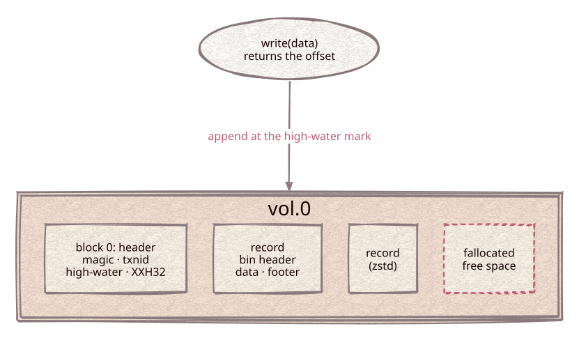

# storage

Part of [Kronuz C++ Libraries](https://github.com/Kronuz/cpp-libraries), a collection of small, reusable C++ libraries.

[](https://github.com/Kronuz/storage/actions/workflows/ci.yml)
[](LICENSE)


An append-only, compressed, multi-volume blob store for C++20: write a record, get
back a stable offset, and read it by that offset later. Each record is compressed
past 100 bytes, checksummed if you want, and committed with the fsync policy you choose.



## ✨ Highlights

- 📎 **Stable offsets**: `write()` appends and returns the record's offset; volumes
  grow in `fallocate`d chunks up to 32 GiB (2³² 8-byte units).
- 🗜️ **Per-record codecs**: Zstandard (default), LZ4, or deflate, chosen at open;
  the codec id lives in each record, so one volume can mix them.
- 🛡️ **Crash-safe header (v2)**: block 0 carries a magic, a commit counter, and an
  XXH32 checksum, small enough to survive a torn 4 KB write.
- 🔎 **Integrity hooks**: your footer type receives an XXH32 of each record and can
  reject it as `StorageCorruptVolume`.
- 💾 **Durability flags**: `STORAGE_FULL_SYNC`, `STORAGE_NO_SYNC`, or
  `STORAGE_ASYNC_SYNC` to hand fsync to your own thread pool.
- 🧩 **Reads Xapiand volumes**: legacy v1 volumes open unchanged; build with
  `STORAGE_LEGACY_SUPPORT=0` to drop that path.

## 📦 Installation

Requires a C++20 compiler and a POSIX system; CMake 3.14 or newer. CI builds it on
Linux (x86_64, arm64), macOS (arm64, x86_64), and FreeBSD, plus ASan, UBSan, and
TSan builds.

```cmake
include(FetchContent)
FetchContent_Declare(storage
  GIT_REPOSITORY https://github.com/Kronuz/storage.git
  GIT_TAG        main)
FetchContent_MakeAvailable(storage)

target_link_libraries(my_app PRIVATE storage::storage)
```

Its dependencies ([compressors](https://github.com/Kronuz/compressors),
[errno-names](https://github.com/Kronuz/errno-names),
[strict-stox](https://github.com/Kronuz/strict-stox),
[stringified](https://github.com/Kronuz/stringified)) come along transitively.

## 🚀 Quick start

```cpp
#include "storage.h"

// The reference framing: a v2 header, a flags+size bin header, an empty footer.
using Blobs = Storage<StorageHeader, StorageBinHeader, StorageBinFooter>;

int main() {
	Blobs s("/var/data/", nullptr);
	s.open("vol.0", STORAGE_CREATE_OR_OPEN | STORAGE_WRITABLE | STORAGE_COMPRESS_ZSTD);
	uint32_t off = s.write("a record");   // the offset to read it back
	s.commit();                            // flush + fsync
	s.close();

	Blobs r("/var/data/", nullptr);
	r.open("vol.0", STORAGE_OPEN);
	r.seek(off);
	std::string data = r.read();           // "a record"
}
```

`Header`, `BinHeader`, and `Footer` are template parameters: define your own to add
magic numbers, UUIDs, or checksums. The fourth parameter routes every file
operation through your IO policy.

## 🎯 When to use it

- ✅ Immutable records addressed by offset: document stores, logs, WAL segments.
- ❌ Updates or deletes in place: records are never rewritten; compact by copying.

## 📊 Performance

`storage_bench` writes and reads 50,000 records of 256 bytes and 200 records of 1 MiB through one volume per codec, one thread, with a warm page cache. A raw row follows each of the none, LZ4 and zstd scenarios: the same records through liblz4 or libzstd and `pwrite`/`pread` alone, in one file with no headers, footers or checksums, one LZ4 block or zstd frame per record. It is the floor the engine's framing is measured against. The table gives MB/s of uncompressed data (write / read), the median of three runs, with Release builds and Apple clang 17; the ratio is record bytes over file bytes.

| Scenario | Apple M4 Pro | Intel i9-9980HK | ratio |
|---|---|---|---|
| small blobs, none | 191 / 190 | 113 / 71 | 0.75 |
| raw `pwrite`/`pread` | 149 / 862 | 74 / 282 | 1.00 |
| small blobs, lz4 | 141 / 173 | 81 / 69 | 0.98 |
| raw lz4 | 124 / 781 | 65 / 295 | 1.38 |
| small blobs, zstd | 59 / 55 | 38 / 46 | 1.23 |
| raw zstd | 53 / 129 | 30 / 94 | 1.70 |
| small blobs, deflate | 38 / 90 | 22 / 46 | 1.29 |
| large blobs, none | 346 / 4,876 | 321 / 1,029 | 0.77 |
| raw `pwrite`/`pread` | 501 / 12,809 | 1,584 / 5,407 | 1.00 |
| large blobs, lz4 | 427 / 1,949 | 321 / 658 | 1.84 |
| raw lz4 | 552 / 3,177 | 706 / 2,148 | 2.42 |
| large blobs, zstd | 454 / 1,262 | 280 / 557 | 3.81 |
| raw zstd | 513 / 1,561 | 348 / 1,145 | 4.95 |
| large blobs, deflate | 36 / 1,750 | 21 / 465 | 4.55 |

The engine reads slower than the raw floor in every row, by 1.2x (large zstd on the M4 Pro) to 5.3x (large uncompressed on the i9); small records read 2.0x to 4.5x slower. A single write row varies by up to 3x between runs on these hosts.

## 📚 Documentation

- [ARCHITECTURE.md](ARCHITECTURE.md): on-disk layout, write and read paths,
  durability and failure modes.
- [docs/INTEGRATION.md](docs/INTEGRATION.md): the IO policy, the async-fsync hook,
  and logging.
- [docs/mechanisms/streamed-write.md](docs/mechanisms/streamed-write.md): writing one
  record in chunks (`Storage::StreamWriter`) and reclaiming orphan volumes.
- [examples/](examples): `toy_wal.cc`, `toy_data_store.cc`, and `bench.cc`
  (throughput and compression ratio per codec).
- [AGENTS.md](AGENTS.md): repository map and invariants.
- [CHANGELOG.md](CHANGELOG.md): behavior changes and their measurements.

## 🛠️ Building and testing

```sh
cmake -B build -DCMAKE_BUILD_TYPE=Release && cmake --build build
ctest --test-dir build      # round trips, multi-volume, checksums, crashes, v2-only, on-disk golden volumes
./build/storage_bench       # throughput and ratio per codec, with raw codec + pwrite/pread rows
```

## 🤝 Contributing

Issues and pull requests are welcome. Read [AGENTS.md](AGENTS.md) first. CI must
pass on every platform.

## 📄 License

MIT, Copyright (c) 2015-2019 Dubalu LLC. See [LICENSE](LICENSE). Extracted from
[Xapiand](https://github.com/Kronuz/Xapiand).
